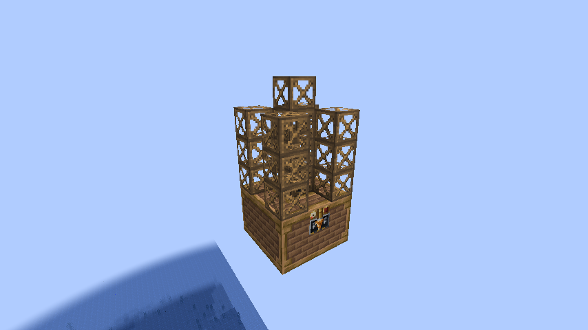
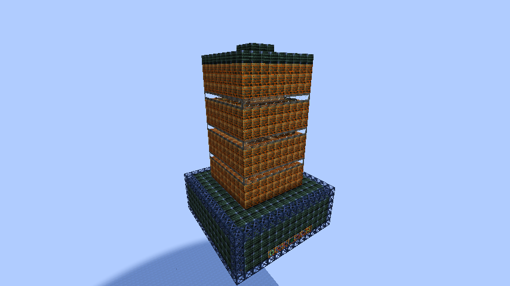
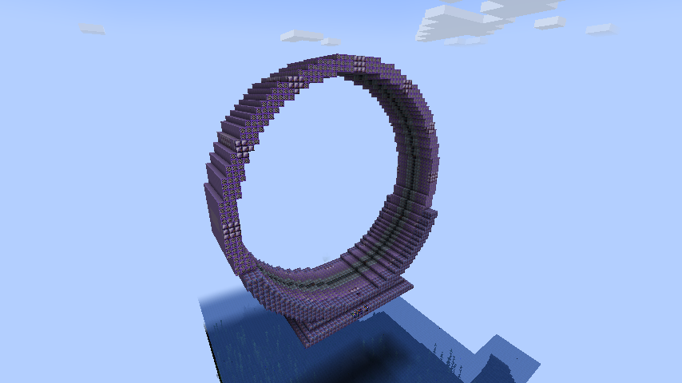

# Gregtech Grindless

A GregTech Modern 7.5.3 modpack for Minecraft 1.20.1 (Forge). You only gather by hand at the very start. After that, everything you need comes out of machines you build and automate, from a steam-powered drill on Earth to a stargate at the edge of the Local Group.

|  |  |  |
|:---:|:---:|:---:|
| Steam vein drill (Steam Age) | Stellar forge (UEV) | Hyperstargate (MAX+, end of the pack) |

## What the pack is like

You start on Earth with the Horizon Collector, a slow machine that makes the basic materials, and a bit of mining by hand. By the end of the Steam Age, vein drills and greenhouses have taken over, and from then on every resource has an automated source.

Each tier brings longer processing lines, new multiblocks and, from HV on, a new place to go: the Moon and Mars, the rest of the Solar System, nearby stars, neutron stars and black holes, Sagittarius A* at the centre of the Milky Way and, at the very end, other galaxies.

The difficulty comes from length and from lines that depend on each other, not from waiting. From MV on, important recipes cost a lot more with every tier, but recipe times are never stretched and every input can be automated. Power is generous: boilers make eight times the steam and generators twice the EU per unit of fuel, but nothing produces energy out of nothing.

Along the way you will find:

- 300 validated multiblocks in v1.5.4, each with an EMI page that explains what it does, on top of GregTech Modern's own machines.
- A quest book with one chapter per tier that introduces new materials, circuits and machines as they appear, plus a flowchart of every processing line.
- Rockets from Gregicality Rocketry in the first space tiers, then orbital stations, probes, warp gates and relays further out.
- Applied Energistics 2 as the logistics backbone, with quantum bridges between planets, and a wireless EU network shared by every dimension.

The pack is in English.

## Tiers

| Tier | Where you go | What happens |
|---|---|---|
| Steam | Earth | Coke, bricks, bronze and steel. Steam drills and greenhouses replace hand mining. |
| LV | The Nether | The first electric factory, AE2 and the wireless EU network. |
| MV | The End | Polymers, fuels and silicon wafers. Production lines start to cross. |
| HV | The Moon | Oil refining, plastics, cleanroom circuits and the first rocket. |
| EV | Moon base, Mars | Titanium, platinum and fine chemistry. |
| IV | Venus, Mercury | Fission power, naquadah, iridium and osmium. |
| LuV | Earth orbit, the asteroid belt, Io, Europa, Ganymede | Cryogenics, superconductors and the first fusion reactor. |
| ZPM | Saturn, Uranus and their moons | Naquadria, the second fusion reactor and orbital stations. |
| UV | Neptune, Triton, Pluto, the Kuiper Belt | Particle accelerators, isotopes and a laser-sail probe to Proxima Centauri. |
| UHV | Proxima Centauri b, Mercury orbit | A Dyson swarm, a warp gate and photonic circuits. |
| UEV | Alpha Centauri, Barnard b, Sirius B | Superheavy elements, megabar matter and optical computing. |
| UIV | A neutron star, a pulsar, Cygnus X-1 | Metallic hydrogen and power from a black hole's spin. |
| UXV | Cygnus X-1, the Vela pulsar, Cassiopeia A | Star lifting, nuclear pasta and spintronics. |
| OpV | A magnetar, the core of Terzan 5 | Antimatter, strangelets and self-replicating machines. |
| MAX | Sagittarius A*, the nuclear star cluster | Industry at the galactic centre, ending with a mirror shell around the black hole. |
| MAX+ | 30 Doradus, the Magellanic Stream, M31, the Local Group filament | Leaving the Milky Way and building the Hyperstargate, the end of the pack. |

The design notes for each tier are in [docs/eras](docs/eras/), and [docs/journey.md](docs/journey.md) walks through the whole progression.

## Installing

The pack is distributed as an instance for [Prism Launcher](https://prismlauncher.org/) that keeps itself up to date.

1. Download `Gregtech-Grindless-releases.zip` from the [releases channel](https://github.com/Ezequiel24123z/GrindlessGregtech/releases/tag/releases-channel).
2. In Prism Launcher, choose Add Instance, then Import, and select the zip.
3. Launch it. The first start downloads about 400 MB of mods.

The instance uses Minecraft 1.20.1, Forge 47.4.28 and Java 17, and is set to use up to 10 GB of memory. Leave the Minecraft and Forge versions as they are.

Each time you launch, the instance checks for a newer tested version and updates the pack files. Your saves are not deleted, but save compatibility is not guaranteed while the pack is in active development. Back up any world you care about before an update; FTB Backups 2 also keeps copies in the instance's `backups` folder. Read the release notes before updating: **v1.5.0 requires a new world.** Worlds from v0.17.0 or earlier do not work.

<details>
<summary>Pinned versions, older instances and manual setup</summary>

Every release on GitHub also has a zip pinned to that version, for example `Gregtech-Grindless-v1.5.4.zip`. A pinned instance never updates.

To move a pinned or older instance to the releases channel without touching its worlds, close Minecraft, open Edit Instance, then Settings, then Custom commands, and set the pre-launch command to:

```
"$INST_JAVA" -jar packwiz-installer-bootstrap.jar https://raw.githubusercontent.com/Ezequiel24123z/GrindlessGregtech/releases/pack/pack.toml
```

Instances that point at `/playable/` still update for now. The old `/jugable/` branch is gone, so those instances need this change to keep updating.

To set up an instance by hand, create a Minecraft 1.20.1 instance with Forge 47.4.28 and Java 17, put [packwiz-installer-bootstrap.jar](https://github.com/packwiz/packwiz-installer-bootstrap/releases) in its `minecraft` (or `.minecraft`) folder and use the command above. Replace `releases` with a version tag such as `v1.5.4` to stay on one version.

Never open an updated world with an older version of the pack. Restore a backup instead.

</details>

## Run a server

A dedicated server needs Java 17, Minecraft 1.20.1 and Forge 47.4.28 (the versions in [pack/pack.toml](pack/pack.toml)). The commands below are for Linux or macOS; on Windows use the same `java` commands in PowerShell.

1. Install the Forge server in an empty folder:

```
mkdir grindless-server && cd grindless-server
curl -fLO https://maven.minecraftforge.net/net/minecraftforge/forge/1.20.1-47.4.28/forge-1.20.1-47.4.28-installer.jar
java -jar forge-1.20.1-47.4.28-installer.jar --installServer
```

2. Install the pack in server mode. This skips the client-only mods. The download is about 330 MB in some 5,000 files and takes a few minutes:

```
curl -fLO https://github.com/packwiz/packwiz-installer-bootstrap/releases/download/v0.0.3/packwiz-installer-bootstrap.jar
java -jar packwiz-installer-bootstrap.jar -g -s server https://raw.githubusercontent.com/Ezequiel24123z/GrindlessGregtech/releases/pack/pack.toml
```

3. Accept the [Minecraft EULA](https://aka.ms/MinecraftEULA) and set the memory. Give the server 8 GB or more:

```
echo eula=true > eula.txt
echo -Xms8G -Xmx8G >> user_jvm_args.txt
```

4. Start it:

```
./run.sh nogui
```

The first boot builds the world and takes a couple of minutes; it may log once that `server.properties` could not be loaded, because the file does not exist yet. Teams, wireless energy and travel are handled by the pack's own mods and scripts, so they need nothing extra on the server. Players join with the same pack version as the server.

FTB Chunks keeps chunks marked for force-loading ticking even when every team member is offline. Merely claiming a chunk does not force-load it. The pack sets `force_load_mode: "always"` in `defaultconfigs/ftbchunks/ftbchunks-world.snbt`, without changing claim protection or chunk limits (25 force-loaded chunks per team by default). Existing worlds may override this with their saved configuration: stop the server, set `force_load_mode: "always"` in `<world>/serverconfig/ftbchunks-world.snbt`, then start it again.

To move to a new version, stop the server, back up the `world` folder, and run the packwiz command from step 2 again. Replace `releases` in the URL with a version tag such as `v1.5.4` to stay on one version. Never start an updated world with an older version of the pack.

## Known issues

- In a world from v1.4.0, large chemical reactors set up for one-step vinyl chloride, TFE or N2O4, and MV electrolyzers that split bastnasite, need the real line's route.
- In a world from v1.3.0, machines set up for the recipes v1.4.0 changed (steel, photographic plates, silicon, polymers, rocket fuel, titanium, rare earths) need their new inputs, and GT--'s chemical plant needs HV machine casings to make peroxide and hydrazine.
- In a world from v1.2.0, the wireless network starts again with an empty store after the update to v1.3.0, and the Hyperstargate forgets who has crossed.
- A Mirror Shell built before v1.2.0 stays unformed until the coils around its windows are replaced with feeder coil casings. The multiblock page in EMI shows where they go.
- The Expanded Assembly Line and the Matrix Data Relay from GTM Extended Features are hidden. They did not run or form reliably, and nothing in the pack needs them.
- Gregicality Rocketry's low gravity setting has no effect in game.

If you find a bug, please open an [issue](https://github.com/Ezequiel24123z/GrindlessGregtech/issues) with the pack version and your `logs/latest.log`.

## Credits

The pack is built on GregTech Modern and its addons (GT Community Additions, GT--, GTM Extended Features and Gregicality Rocketry), KubeJS, FTB Quests, Applied Energistics 2 and more than 200 other mods, all listed in [pack/mods](pack/mods/). The mods are downloaded from their official pages when the instance updates, and each one keeps its own licence.

Many of the machines started as ideas from other GregTech packs and were rebuilt to fit this one: GregTech Leisure, Star Technology, GTNH, Monifactory, Nomifactory, Supersymmetry, Gregicality Science and TerraFirmaGreg among them. [CREDITS.md](CREDITS.md) lists what came from where.

Some addon machines were removed or moved to a later tier because they skipped a processing line or produced free energy. Their items are hidden in EMI.

## License

The pack's own files (scripts, quests, configs, textures, sounds, tools and documentation) are released under the [MIT License](LICENSE). The mods are not part of this repository and each keeps its own licence, as does any third-party material listed in [CREDITS.md](CREDITS.md).

## Working on the pack

The pack is defined with [packwiz](https://github.com/packwiz/packwiz) in [pack](pack/). Most of the content lives in the KubeJS scripts under [pack/kubejs](pack/kubejs/) and the quest files under [pack/config/ftbquests](pack/config/ftbquests/). [tools](tools/) has the generators, the validators and the test bench, and [docs](docs/) has the design notes; [docs/README.md](docs/README.md) explains what is where.
