# Making a multiblock in Gregtech Grindless

A practical, picture-first guide for anyone who wants to add a multiblock or make an existing one look better. You should
know GregTech as a player and be able to read a little JavaScript. Everything here is how the pack already does it, with two
real machines as examples.

Every drawing in this guide is made from the shape's code by `tools/analysis/structure-svg.mjs`, so you can draw your own
(section 10).

**Contents**

1. [What a multiblock is](#1-what-a-multiblock-is)
2. [How to read a shape](#2-how-to-read-a-shape)
3. [The five pieces of code](#3-the-five-pieces-of-code)
4. [Example 1: the Steam Vein Drill](#4-example-1-the-steam-vein-drill)
5. [Example 2: the Submerged Arc Furnace](#5-example-2-the-submerged-arc-furnace)
6. [Register the machine](#6-register-the-machine)
7. [Make it look good](#7-make-it-look-good)
8. [Names, tooltips and EMI info](#8-names-tooltips-and-emi-info)
9. [Recipes](#9-recipes)
10. [Try it and test it](#10-try-it-and-test-it)
11. [Reshaping an existing multiblock](#11-reshaping-an-existing-multiblock)
12. [Where to start](#12-where-to-start)
13. [Design checklist](#13-design-checklist)
14. [Traps](#14-traps)
15. [Sending your work](#15-sending-your-work)

## 1. What a multiblock is

A multiblock is a big machine built from many blocks. You place the blocks in the right shape, and the **controller**
checks it. When every block is right, the machine **forms** and works as one machine.

| Steam Vein Drill (Steam era) | Submerged Arc Furnace (LV) |
|---|---|
| 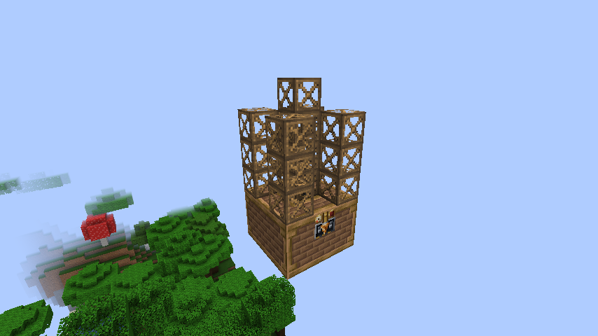 | 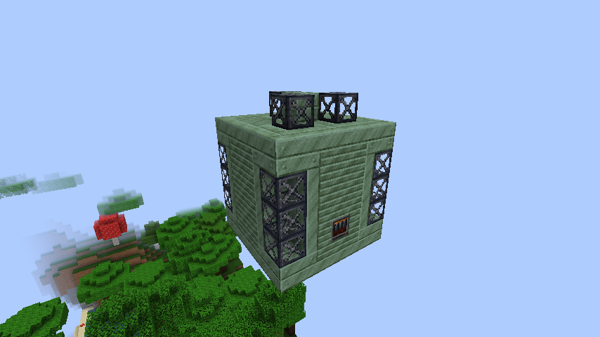 |

Each multiblock is made of these kinds of block:

| Block | Its job | Example |
|---|---|---|
| **Controller** | The brain. You click it to open the machine, and it checks the shape. Exactly one. | the arc furnace's front block |
| **Casing** | The walls. Most of the body. | heatproof machine casing |
| **Hatches and buses** | The doors: buses move items, hatches move fluids, the energy hatch brings power, the muffler lets smoke out. | input bus, energy hatch |
| **Detail blocks** | They show what the machine does. | glass, pipes, frames, coils |
| **Air** | Cells that must stay empty, like the inside of a furnace. | |

## 2. How to read a shape

Let's start with a tiny toy machine. It is not in the pack; it only teaches how to read a shape.

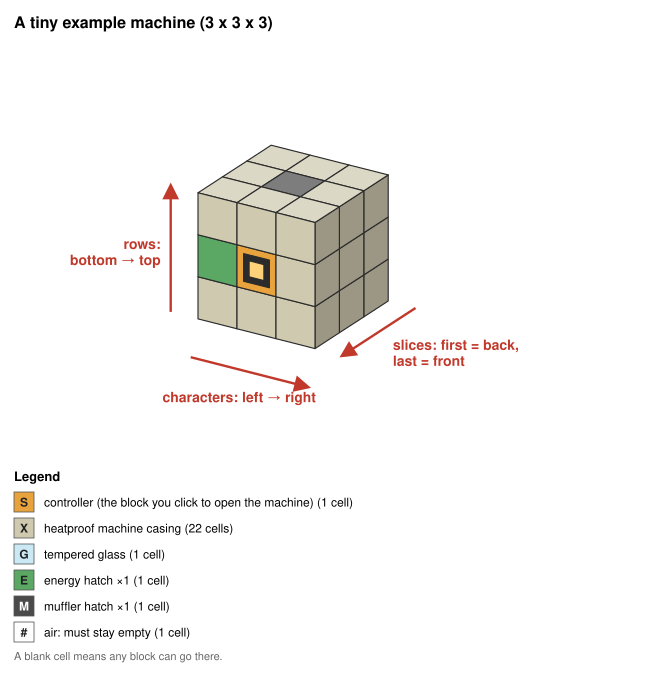

How the pictures work: the controller is the orange block with a dark square; frames have a square inset; glass is
see-through; air and "any block" cells are not drawn.

A shape is written as text. It is a list of **slices**; each slice is a list of **rows**; each row is a string with one
**character** per block. Three rules tell you where each character goes:

| Part | Goes from | To |
|---|---|---|
| Slices | the **back** of the machine | the **front**. The controller is in the last slice. |
| Rows (inside a slice) | the **bottom** | the **top** |
| Characters (inside a row) | **left** | **right**, as you stand in front of the controller and look at it |

Here is the same machine with its slices pulled apart. Slice 1 is the back wall, slice 3 is the front wall with the
controller:

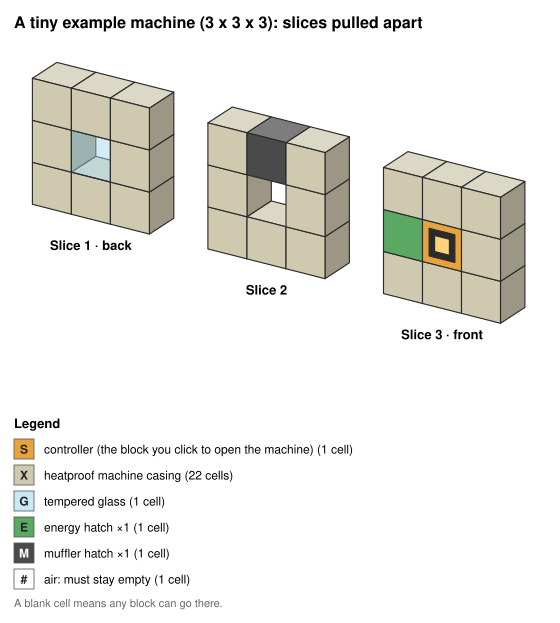

And here is its code:

```js
const HEAT_CASING = 'gtceu:heatproof_machine_casing'

const TOY_SPEC = {
  slices: [
    // slice 1, the back: a window (G) in the middle
    ['XXX', 'XGX', 'XXX'],
    // slice 2, the middle: empty inside (#), with the muffler (M) on the roof
    ['XXX', 'X#X', 'XMX'],
    // slice 3, the front: the energy hatch (E) on the left of the controller (S)
    ['XXX', 'ESX', 'XXX']
  ],
  symbols: {
    S: Pat.controller(),
    X: Pat.block(HEAT_CASING),
    G: Pat.block('gtceu:tempered_glass'),
    E: Pat.part('energy_input', { exact: 1 }),
    M: Pat.part('muffler', { exact: 1 }),
    '#': Pat.air()
  }
}
```

Read slice 3, `['XXX', 'ESX', 'XXX']`, row by row from the bottom:

- `'XXX'`: the bottom row is all casing.
- `'ESX'`: the middle row is the energy hatch on your left, the controller in the middle, and casing on your right.
- `'XXX'`: the top row is all casing.

Now find each of those blocks in the pictures. The flat view below shows every slice as you see it standing in front of
the controller:

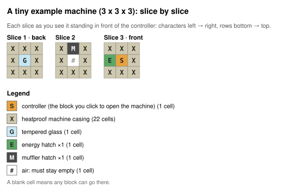

Every character other than a space is a **symbol**, and `symbols` says which blocks it accepts. A space means "any block".

> **Left and right.** In this pack's shapes, left and right are always **yours** as you face the controller. GTM's Java
> code names directions from the machine's point of view, so its "left" is your right. Trust the pictures.

**Try it** (answers below):

1. Move the energy hatch to the right of the controller.
2. Replace the back window with casing.
3. This toy could never run a recipe. Why?

<details>
<summary>Answers</summary>

1. Slice 3's middle row becomes `'XSE'`.
2. Slice 1's middle row becomes `'XXX'`, and the `G` symbol can go.
3. It has no input or output bus or hatch, so nothing can go in or come out.

</details>

## 3. The five pieces of code

A GregTech Modern (GTM 7.5.3) multiblock is five things:

| Piece | What it is | Where it lives |
|---|---|---|
| Shape | Which block goes in each cell, and where the hatches may go | the machine's startup script, as a `SPEC` |
| Machine | The controller block: its name, recipe type, shape and look | the same startup script |
| Recipe type | The list of recipes it runs (a new one, or one GTM already has) | the same startup script |
| Looks | The casing it shows when formed, plus the textures of the controller's front face | `appearanceBlock`, `workableCasingModel`, `pack/kubejs/assets/grindless/textures/` |
| Recipes | The controller's own crafting recipe and the recipes it runs | `pack/kubejs/server_scripts/grindless/<era>/` |

Names and tooltips go in `pack/kubejs/client_scripts/grindless/<era>_<machine>_lang.js`, in English.

The arc furnace's files:

- `pack/kubejs/startup_scripts/grindless/lv/multis.js`: the shape (`ARC_FURNACE_SPEC`), the recipe type (`arc_smelting`) and the machine.
- `pack/kubejs/server_scripts/grindless/lv/crafting_multis.js`: the controller recipe.
- `pack/kubejs/server_scripts/grindless/lv/arc_furnace.js`: the recipes it runs.
- `pack/kubejs/client_scripts/grindless/lv_multis_lang.js` and `lv_info_lang.js`: the name, tooltips and EMI info text.
- `pack/kubejs/assets/grindless/textures/block/multiblock/submerged_arc_furnace/`: the controller face.

To find every file that touches a machine: `git grep -n "submerged_arc_furnace" -- pack tools`.

## 4. Example 1: the Steam Vein Drill

A small machine: 3 wide, 6 tall, 3 deep. A steam-powered house at the bottom, a pipe going down through its middle, and a
frame mast with a drill tower on top.

| In 3D | Slice by slice |
|---|---|
| 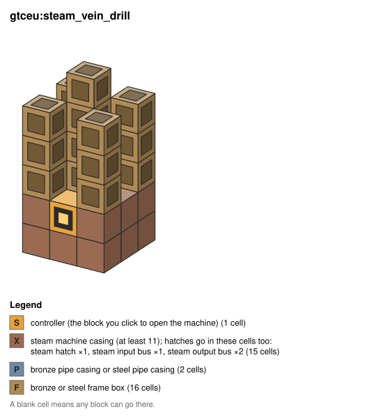 | 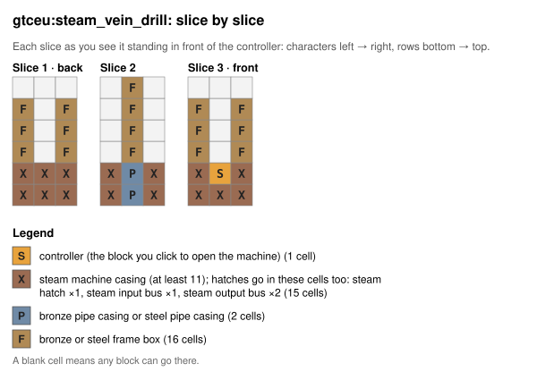 |

Its shape, from `pack/kubejs/startup_scripts/grindless/steam/machines.js`:

```js
const DRILL_SPEC = {
  slices: [
    // back
    ['XXX', 'XXX', 'F F', 'F F', 'F F', '   '],
    // middle: the pipe goes through the house and ends in a frame mast
    ['XPX', 'XPX', ' F ', ' F ', ' F ', ' F '],
    // front (controller)
    ['XXX', 'XSX', 'F F', 'F F', 'F F', '   ']
  ],
  symbols: {
    S: Pat.controller(),
    // 15 house cells: 4 are parts, the rest steam machine casing
    X: Pat.oneOf(
      Pat.block(CASING, { min: 11 }),
      Pat.part('steam', { exact: 1 }),
      Pat.part('steam_input_bus', { exact: 1 }),
      Pat.part('steam_output_bus', { exact: 2 })
    ),
    P: Pat.block(['gtceu:bronze_pipe_casing', 'gtceu:steel_pipe_casing']),
    F: Pat.frame(['bronze', 'steel'])
  }
}
```

What to notice:

- **`X` is "casing or a hatch".** `Pat.oneOf` lets the player put the hatches anywhere on the house. `min: 11` makes sure at
  least 11 of the 15 house cells are real casing, so nobody builds the house out of hatches.
- **`exact` on every hatch the recipes need**: one steam hatch, one input bus, two output buses.
- **Spaces are "any block".** The tower's corners and the air around the mast are left free, so the player can put
  anything there.
- **Two materials are fine.** The pipe can be bronze or steel, and so can the frames.

## 5. Example 2: the Submerged Arc Furnace

A bigger machine: 5 wide, 6 tall, 5 deep. A firebrick hearth inside a heatproof box, three electrodes (a coil tip on a
steel frame stem) coming down through the roof, and a flue pipe with a muffler to let the smoke out.

| In 3D | Slices pulled apart |
|---|---|
| 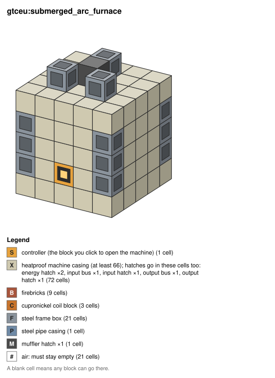 | 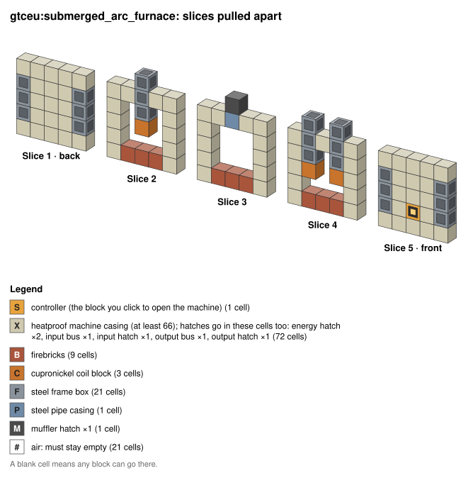 |

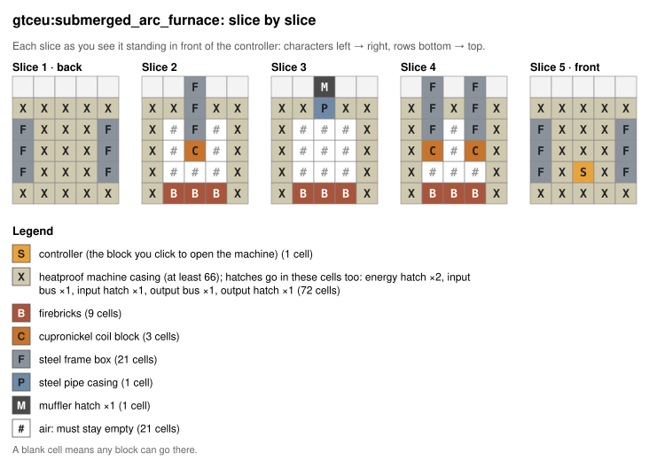

Its shape, from `pack/kubejs/startup_scripts/grindless/lv/multis.js`. Read each line as one slice, from the floor up:

```js
const ARC_FURNACE_SPEC = {
  slices: [
    // back wall
    ['XXXXX', 'FXXXF', 'FXXXF', 'FXXXF', 'XXXXX', '     '],
    // electrode 1: coil tip (C), steel frame stem (F) through the roof
    ['XBBBX', 'X###X', 'X#C#X', 'X#F#X', 'XXFXX', '  F  '],
    // flue pipe (P) in the roof and the muffler (M) on top
    ['XBBBX', 'X###X', 'X###X', 'X###X', 'XXPXX', '  M  '],
    // electrodes 2 and 3
    ['XBBBX', 'X###X', 'XC#CX', 'XF#FX', 'XFXFX', ' F F '],
    // front wall with the controller (S)
    ['XXXXX', 'FXSXF', 'FXXXF', 'FXXXF', 'XXXXX', '     ']
  ],
  symbols: {
    S: Pat.controller(),
    X: Pat.oneOf(                                   // the body: casing OR one of the hatches
      Pat.block(HEAT_CASING, { min: 66 }),
      Pat.part('energy_input', { exact: 2 }),
      Pat.part('input_bus', { exact: 1 }),
      Pat.part('input_hatch', { exact: 1 }),
      Pat.part('output_bus', { exact: 1 }),
      Pat.part('output_hatch', { exact: 1 })
    ),
    B: Pat.block('gtceu:firebricks'),
    C: Pat.block('gtceu:cupronickel_coil_block'),
    F: Pat.frame(['steel']),
    P: Pat.block('gtceu:steel_pipe_casing'),
    M: Pat.part('muffler', { exact: 1 }),
    '#': Pat.air()
  }
}
```

Follow one electrode: in slice 2, the `C` sits in row 3, the `F` above it in row 4, another `F` in the roof (row 5) and one
more sticking out on top (row 6). In the exploded picture, that is the column in the second slice.

Every shape uses the pack's pattern helper, `pack/kubejs/startup_scripts/grindless/lib/patterns.js` (`Pat`). Never call
GTM's pattern API directly: when GTM 8 arrives, only that helper has to change. The predicates:

| Predicate | Meaning |
|---|---|
| `Pat.controller()` | The controller. Exactly one cell. |
| `Pat.block(id or [ids], {min, max, exact})` | One of these blocks. Limits work only with a single id. |
| `Pat.frame(['steel'])` | GT frame blocks of these materials. Material ids use underscores: `stainless_steel`, `tungsten_steel`. |
| `Pat.part(name, {min, max, exact})` | A hatch or bus. Names: `input_bus`, `output_bus`, `input_hatch`, `output_hatch`, `energy_input`, `energy_output`, `muffler`, `maintenance`, and `steam`, `steam_input_bus`, `steam_output_bus` for steam machines. |
| `Pat.oneOf(a, b, ...)` | Any of these. The usual "casing or hatch" cell. |
| `Pat.air()` / `Pat.any()` | Must be air / anything. A space in a row is the same as `Pat.any()`. |

How to write your own shape:

1. Sketch it first, one layer at a time, on squared paper or in a creative world. Then type the slices.
2. Every row of every slice has the same length, and every slice has the same number of rows.
3. Give the body symbol (`X`) a `min` on the casing: count the `X` cells and subtract the hatches.
4. Put `exact` or `max` on every hatch the recipes need. The arc furnace needs exactly 2 energy hatches because its recipes
   draw 2 A.
5. Keep every hatch cell on the outside, where a player can reach it.
6. Draw it (section 10) and compare the picture with what you had in mind.

## 6. Register the machine

If no recipe type fits, register a new one. Most multiblocks reuse one GTM already has.

```js
GTCEuStartupEvents.registry('gtceu:recipe_type', function (event) {
  event.create('arc_smelting')
    .category('multiblock')
    .setEUIO('in')
    .setMaxIOSize(4, 3, 1, 2)          // item in, item out, fluid in, fluid out
    .setProgressBar(GuiTextures.PROGRESS_BAR_ARC_FURNACE, FillDirection.LEFT_TO_RIGHT)
    .setSound(GTSoundEntries.ARC)
})
```

Then the machine. Record the shape with `Pat.register` first: the test tools and the drawing tool read it from there.

```js
GTCEuStartupEvents.registry('gtceu:machine', function (event) {
  Pat.register('gtceu:submerged_arc_furnace', ARC_FURNACE_SPEC)

  event.create('submerged_arc_furnace', 'multiblock')
    .langValue('Submerged Arc Furnace')
    .rotationState(RotationState.NON_Y_AXIS)
    .recipeType('arc_smelting')
    .appearanceBlock(GTBlocks.CASING_INVAR_HEATPROOF)
    .pattern(function (def) { return Pat.build(def, ARC_FURNACE_SPEC) })
    ["tooltips(net.minecraft.network.chat.Component[])"]([
      Text.translate('grindless.machine.submerged_arc_furnace.tooltip.0'),
      Text.translate('gtceu.machine.available_recipe_map_1.tooltip', Text.translate('gtceu.arc_smelting'))
    ])
    .workableCasingModel('gtceu:block/casings/solid/machine_casing_heatproof',
      'grindless:block/multiblock/submerged_arc_furnace')
})
```

IDs: our machines and recipe types are `gtceu:...`. Our items and blocks, casings included, are `grindless:...`.

Copy one of these patterns when your machine needs more than plain recipes:

- `lib/generators.js`: generators. They must use `.regressWhenWaiting(false)`.
- `lib/mega.js` and `lib/parallel_hatch.js`: parallels and parallel hatches. `uev/electron_beam.js` is a late-era example.
- `lib/coils.js`: coil-tier machines.
- `lib/no_voiding.js` and `lib/fresh_run.js`: machines that must not void outputs, or that are priced by time of day.

Files under `lib/` are shared. Use them, but don't change them in the same pull request as a machine.

## 7. Make it look good

- **`appearanceBlock`** is the casing the hatches and controller copy when formed. Use the body's main casing.
- **`workableCasingModel(casingTexture, overlayDir)`** draws the controller: the casing texture plus the face from
  `overlayDir`. It needs `overlay_front.png`, `overlay_front_active.png` and `overlay_front_active_emissive.png` (only the
  pixels that glow), each with its `.png.mcmeta` when animated.
- Our textures are procedural 16x16 pixel art made by the `tools/assets/Build-*Textures.ps1` scripts. Nothing is copied from
  GTM or other mods. To add a face, add a generator (or extend your era's) and run it. Don't hand-edit the PNGs.
- **New casings** are blocks registered in the era's `casings.js`, like `uev/casings.js`. From UEV on, a multiblock's body is
  made of its era's own casing family, and each family casing needs something only that era makes.

## 8. Names, tooltips and EMI info

In the era's lang file (for example `client_scripts/grindless/lv_multis_lang.js`):

```js
add('block.gtceu.submerged_arc_furnace', 'Submerged Arc Furnace')
add('gtceu.arc_smelting', 'Arc Smelting')
add('grindless.machine.submerged_arc_furnace.tooltip.0', '§7Reduces and melts in an electric arc: silicon, sky dust, obsidian.')
```

Every machine also gets an EMI info page saying what it is for and what it needs (`emi.grindless.info.<machine>.N` in
`<era>_info_lang.js`). Use English only: the checks fail on any other language.

## 9. Recipes

The controller recipe (`server_scripts/grindless/lv/crafting_multis.js`):

```js
event.recipes.gtceu.shaped('gtceu:submerged_arc_furnace', ['ESE', 'CHC', 'BBB'], {
  E: 'grindless:graphite_electrode',
  S: '#forge:plates/steel',
  C: '#gtceu:circuits/lv',        // always the circuit tag, never one specific circuit
  H: 'gtceu:lv_machine_hull',
  B: 'gtceu:heatproof_machine_casing'
}).id('grindless:crafting/submerged_arc_furnace')
```

The recipes it runs (`server_scripts/grindless/lv/arc_furnace.js`) are wrapped in
`global.grindless.recipes('<era>/<file>', fn)`, so one broken script can't stop the others:

```js
global.grindless.recipes('lv/arc_furnace', function (event) {
  event.recipes.gtceu.arc_smelting('grindless:silicon')      // saved as grindless:arc_smelting/silicon
    .itemInputs('3x gtceu:quartz_sand_dust', '2x gtceu:coke_dust')
    .chancedInput('grindless:graphite_electrode', 300, 0)
    .circuit(1)
    .itemOutputs('1x ae2:silicon')
    .outputFluids(Fluid.of('gtceu:carbon_dioxide', 2000))
    .EUt(32, 2).duration(200)
})
```

Pack rules for recipes:

- Every input must be automatable.
- Every byproduct needs a place to go.
- Cost comes from steps and quantity, never from a longer recipe time.

## 10. Try it and test it

**Draw it.** The fastest check is a picture. From the repo's root:

```
node tools/analysis/structure-svg.mjs gtceu:submerged_arc_furnace --out my-pictures --explode 1.5
```

It reads the pack's scripts (about 80 s) and writes `submerged-arc-furnace-3d.svg`, `-slices.svg` and `-exploded.svg`.
Open them in a browser. Add `--axes` for the red arrows. You can name several machines at once.

To draw a shape that is not in the pack yet, write it as a JSON file, like
[`specs/tiny-furnace.json`](images/multiblock-tutorial/specs/tiny-furnace.json), and pass the file instead of the id. The
JSON uses plain data instead of `Pat`: `{"kind": "blocks", "blocks": ["gtceu:firebricks"]}`,
`{"kind": "part", "ability": "muffler", "limits": {"exact": 1}}`, `{"kind": "controller"}`, `{"kind": "air"}`.

**In game.** Install the pack in Prism, then edit the scripts in the instance's `minecraft/kubejs/` folder and copy them
back into the repo's `pack/kubejs/` when they work.

- **Startup scripts** (shapes, machines, recipe types, blocks) load once: **restart the game** after every change.
- **Server scripts** (recipes): `/reload`.
- **Client scripts** (names): `/kubejs reload client_scripts`, or F3+T.
- Errors go to `minecraft/logs/kubejs/startup.log` and `server.log`. Read them after every restart.

Then check, in this order:

1. The game starts, and the logs are clean.
2. EMI shows the structure preview (open the controller's recipes) and the recipes it runs.
3. GTM's Terminal builds the whole structure from your inventory (use creative), and the controller forms.
4. A recipe runs.
5. The controller face lights up while it works.

**With the repo's checks:**

- `node tools/analysis/structure-quality.mjs --static --top 20` scores the shapes against the checklist (about 80 s).
- `tools\Check-Fast.ps1` runs all the fast checks (T0). GitHub Actions also runs it on every push and pull request.
- The maintainer runs the in-game test bench, which builds and forms every multiblock (`docs/testing/usage.md`, form sweep).

## 11. Reshaping an existing multiblock

This is the easiest way to start: improve how a machine looks without changing what it does. Here is the arc furnace
before and after its reshape. Same size, same hatches, same recipes:

| Before: a plain box | After: you can see what it does |
|---|---|
| 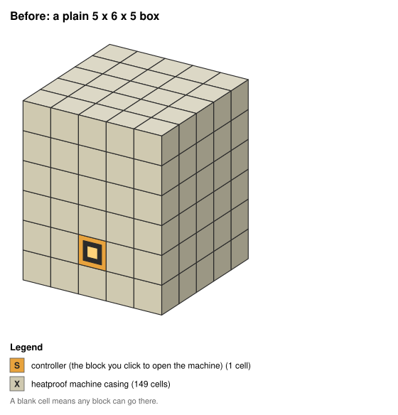 |  |

What changed:

- A firebrick hearth and an empty inside: it is a furnace, not a solid block.
- Three electrodes (coil tips on frame stems) through the roof: the arc.
- A flue pipe and a muffler on top: where the smoke goes.
- Frames on the corners of the front and back walls: the steel skeleton.

How to do it:

1. Find its `SPEC` with `git grep -n "<machine id>" -- pack/kubejs/startup_scripts`.
2. Draw it as it is now (section 10).
3. Change only `slices` and `symbols`. Keep the machine id and the hatches the recipes need.
4. If the hatch counts change, update the tooltips and the EMI info text that list them.
5. Draw it again, then restart the game and check the EMI preview, the Terminal build and forming.
6. Rewrite the shape baseline: `node tools/analysis/structure-quality.mjs --static --write-baseline`.
7. Say in the pull request that the shape changed. Players have to rebuild the machine.

## 12. Where to start

- Run `node tools/analysis/structure-quality.mjs --static --top 20`. It lists the 20 weakest shapes and what each one breaks.
- The MAX-era machines need the most love. Their shapes are in `pack/kubejs/startup_scripts/grindless/max/`. Draw a few
  (for example `node tools/analysis/structure-svg.mjs gtceu:<id> --out my-pictures`) and pick one that bothers you.
- Read `docs/quality/structures.md` before a big redesign: it has the full rules, including sizes by tier.

## 13. Design checklist

T0 enforces the first four.

- [ ] Not a solid box, and not a hollow box of one casing.
- [ ] No block is more than 70% of the cells.
- [ ] At least 3 kinds of block.
- [ ] At least 2 kinds of detail that show the process: glass windows, pipes, frames, coils, gearboxes.
- [ ] The silhouette says what it does: a tower for a column, a ring for a ring, a long hall for a line.
- [ ] The size fits the tier and the job (field unit, workhorse, plant or hall, flagship). From UV on, machines are big.
      Never pad a shape just to reach a size.
- [ ] From UEV on, the body is the era's own casings. A machine never contains a casing that needs that machine's own
      product, or the era deadlocks.
- [ ] The controller face lights up: `appearanceBlock` plus `workableCasingModel`.
- [ ] The Terminal can build it.
- [ ] At most 264 active blocks (such as coils) per structure.

## 14. Traps

- **`var`, not `const` or `let`, inside functions, callbacks and loops.** The script engine (Rhino) keeps the first loop
  iteration's `const`. Once, that turned 13 shapes into solid boxes.
- **Wrong frame material.** An unknown `Pat.frame` material throws at startup and stops every later registration in the
  pack.
- **Rows of different lengths.** Every row of every slice must be as long as the others.
- **Two recipes of one type with the same inputs** collide, and one never runs. Give each its own circuit or input.
- **IDs get the recipe type in front.** `event.recipes.gtceu.assembler('grindless:x')` is saved as `grindless:assembler/x`.
- **Don't use `Java.to`** in a `Predicates.custom` preview. It once broke EMI's whole GTM integration.
- **Don't write `// priority:` headers by hand.** A tool generates them.
- More traps: `.github/instructions/kubejs.instructions.md`.

## 15. Sending your work

1. Fork the repo and branch from the integration branch (`docs/STATUS.md` names it; it is not `main`).
2. Keep one machine, or one reshape, per pull request.
3. Open the pull request against the integration branch. Say what changed and how you tested it. Pictures from section 10
   help a lot.
4. Write everything in English: code, comments, names and docs.
5. Licences: read `CREDITS.md` before copying anything from another mod. MIT or LGPL code needs credit. GPL,
   non-commercial or all-rights-reserved code is ideas only.
6. Don't touch generated files (`pack/index.toml`, the generated quest chapters, `hidden_until.json`): the maintainer
   regenerates them. The quest book's Multiblocks chapter picks up a new controller on its own.
